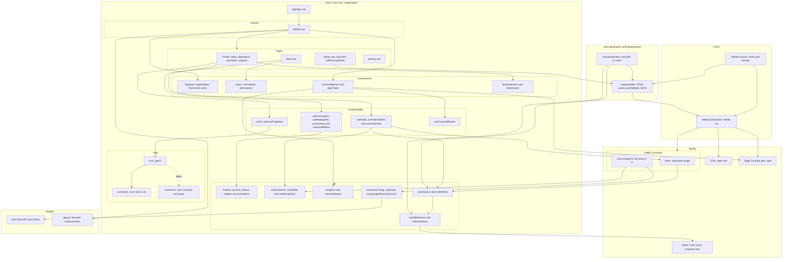
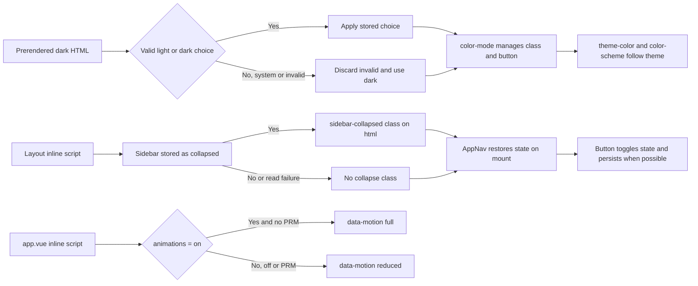

# Architecture

[Index](README.md) · [Types](types.md) · [Visits and GA4](ga4.md) · [Features](features.md) · [Security](security.md) · [Deployment](deployment.md)

## Modules and execution boundaries

**Reading the diagram:** the browser does not call the Data API and does not know service account credentials.
The public function reads an aggregated snapshot; the scheduled job queries GA4.
`lib/` mixes pure logic and I/O adapters: not all of that directory is client or pure code.
The diagram groups modules; it does not represent every import.

Sources: [Nuxt config](../nuxt.config.ts), [layout](../app/layouts/default.vue),
[useCv](../app/composables/useCv.ts), [getCv](../data/cv.ts), [useVisits](../app/composables/useVisits.ts),
[Netlify](../netlify.toml), and [workflow](../.github/workflows/ci.yml).
CV Zod schemas are validated in tests; `getCv` joins facts and copy without parsing in the browser.
`/en/books` and `/es/libros` generate minimal HTML with jump to Profile anchor, not a standalone books page;
Nuxt scripts and payloads are disabled, not the inline jump script.

## Preferences before first paint

Sources: [app.vue](../app/app.vue), [theme](../lib/theme.ts), [sidebar](../lib/sidebar.ts),
[animations](../lib/animations.ts), [AppNav](../app/components/AppNav.vue), and [CSS](../app/assets/css/main.css).
Theme **does not** read system preference. Animations start off; on load, PRM overrides a stored `on`.
Collapse only changes presentation from `xl`; mobile has bottom bar and tablet has rail.
Preference scripts are included in CSP hashes. This flow describes preferences,
not all journey geometric transitions.
