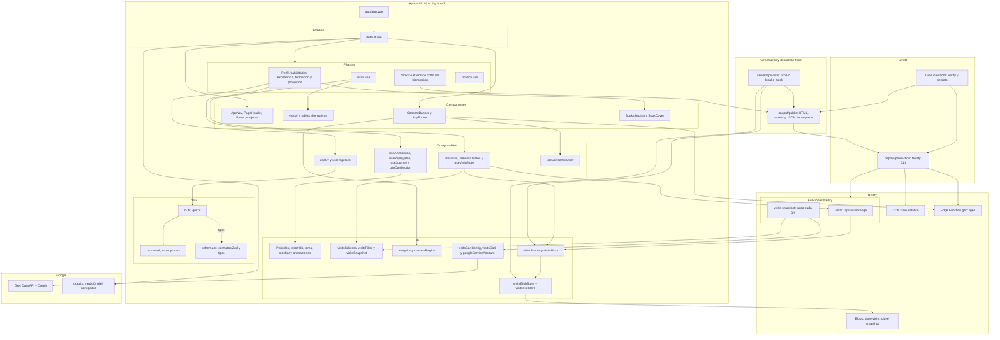
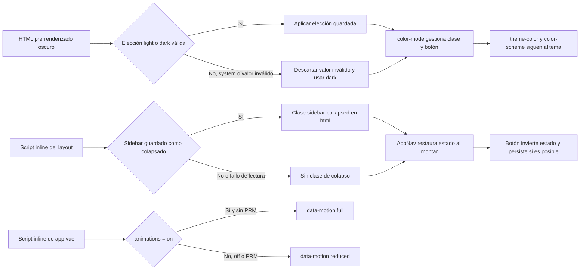

# Arquitectura

[Índice](README.md) · [Tipos](tipos.md) · [Visitas y GA4](ga4.md) · [Funcionalidades](funcionalidades.md) · [Seguridad](seguridad.md) · [Despliegue](despliegue.md)

## Módulos y límites de ejecución

**Lectura:** el navegador no llama a la Data API ni conoce las credenciales de la cuenta de servicio.
La función pública lee un snapshot agregado; la tarea programada es quien consulta GA4.
`lib/` mezcla lógica pura y adaptadores con E/S: no todo ese directorio es código de cliente ni puro.
El diagrama agrupa módulos, no representa cada importación.

Fuentes: [configuración Nuxt](../nuxt.config.ts), [layout](../app/layouts/default.vue),
[useCv](../app/composables/useCv.ts), [getCv](../data/cv.ts), [useVisits](../app/composables/useVisits.ts),
[Netlify](../netlify.toml) y [workflow](../.github/workflows/ci.yml).
Los esquemas Zod del CV se validan en tests; `getCv` une hechos y textos sin parsear en el navegador.
`/en/books` y `/es/libros` generan HTML mínimo con salto al ancla del Perfil, no una página de libros independiente;
se desactivan scripts de Nuxt y payloads, no el script inline de salto.

## Preferencias antes del primer pintado

Fuentes: [app.vue](../app/app.vue), [theme](../lib/theme.ts), [sidebar](../lib/sidebar.ts),
[animations](../lib/animations.ts), [AppNav](../app/components/AppNav.vue) y [CSS](../app/assets/css/main.css).
El tema **no** consulta la preferencia del sistema. Las animaciones arrancan apagadas; al cargar, PRM manda sobre un `on` guardado.
El colapso solo cambia la presentación desde `xl`; en móvil hay barra inferior y en tablet raíl.
Los scripts de preferencias entran en los hashes CSP. Este flujo describe las preferencias,
no todas las transiciones geométricas del recorrido.
