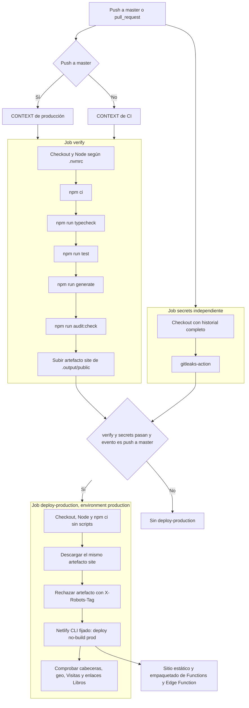
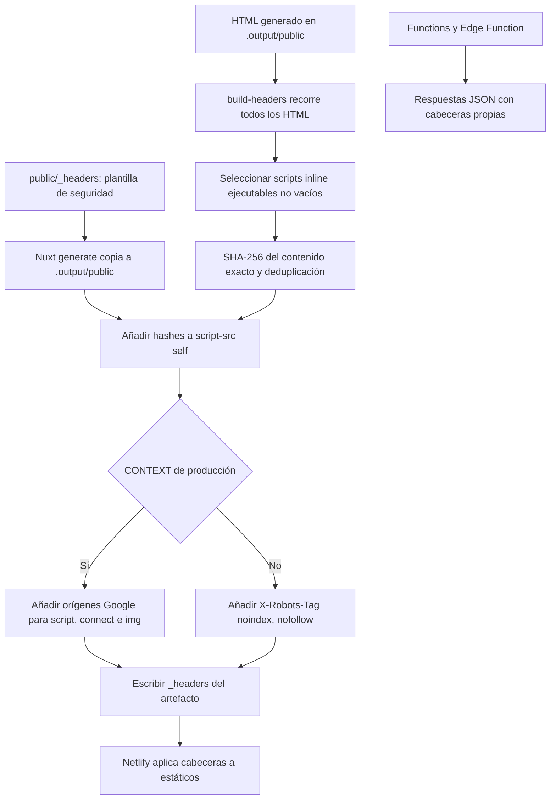

# CI/CD y CSP

[Índice](README.md)

Fuentes: [workflow](../.github/workflows/ci.yml), [package.json](../package.json),
[netlify.toml](../netlify.toml), [audit](../scripts/audit.mjs),
[Dependabot](../.github/dependabot.yml).
El permiso global de Actions es `contents: read`; las acciones se fijan por SHA.
Los nombres de secretos usados son `GITHUB_TOKEN`, `NETLIFY_AUTH_TOKEN` y `NETLIFY_SITE_ID`;
los dos de Netlify se exponen en el paso de deploy, no al build de PR.
La retención del artefacto es de siete días y la concurrencia del deploy no cancela otro despliegue en curso.
`audit:check` bloquea avisos high/critical no aceptados; la lista de excepciones del código base está vacía.
Dependabot propone actualizaciones semanales de npm y Actions, sin auto-merge en la configuración versionada.

**Límites:** declarar `environment: production` permite reglas externas, pero no demuestra que exista
aprobación manual ni protección de rama. Tampoco este YAML demuestra que Netlify tenga desactivados
sus builds autónomos; `netlify.toml` conserva un comando de tests y generación para esos builds.
En esta revisión de `master`, el workflow **no** contiene Lighthouse, axe ni umbral de cobertura;
no se documentan como existentes las PRs paralelas aún no incorporadas.

## Generación de cabeceras

Fuentes: [script de cabeceras](../scripts/build-headers.mjs),
[plantilla](../public/_headers), [analytics](../lib/analytics.ts),
[función Visitas](../netlify/functions/visits.ts) y [geo](../netlify/edge-functions/geo.ts).
El selector excluye scripts externos y los tipos JSON/JSON-LD que contempla su expresión regular;
no es un parser HTML general. Los inline de consentimiento, tema, sidebar, movimiento y salto
corto de Libros quedan cubiertos cuando aparecen en el HTML generado.
No se añaden `unsafe-inline` ni `unsafe-eval` para scripts; `style-src` mantiene su excepción inline.
La plantilla incluye HSTS, nosniff, DENY y `frame-ancestors 'none'`, Referrer-Policy,
Permissions-Policy y COOP. Las funciones no heredan `_headers`: geo fija no-store, nosniff y HSTS;
Visitas añade nosniff, HSTS y, en respuestas válidas, caché y diagnóstico de fuente.
