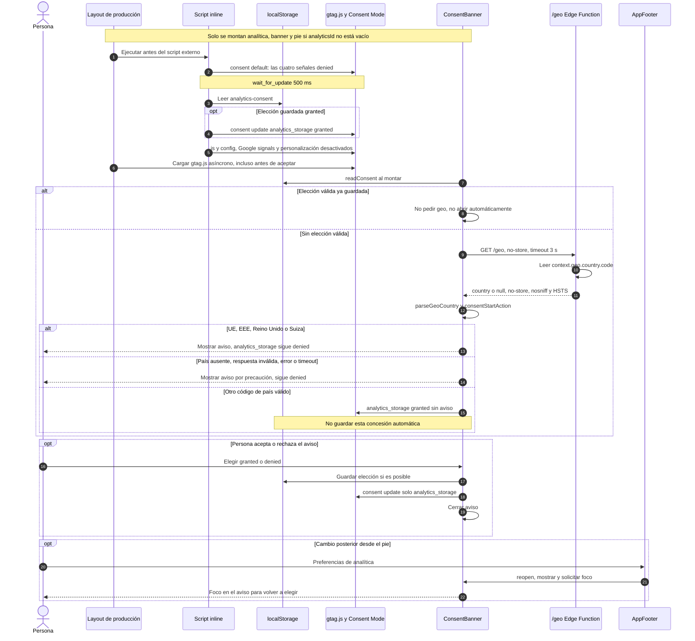

# Banner y Consent Mode v2

[Índice](README.md)

Fuentes: [configuración Nuxt](../nuxt.config.ts), [layout](../app/layouts/default.vue),
[analytics](../lib/analytics.ts), [región](../lib/consentRegion.ts),
[Edge Function](../netlify/edge-functions/geo.ts), [banner](../app/components/ConsentBanner.vue),
[estado compartido](../app/composables/useConsentBanner.ts), [pie](../app/components/AppFooter.vue).

## Condiciones exactas

- El build lleva analítica solo si `CONTEXT` indica producción; `analyticsId` queda vacío en el resto.
- El `default` establece `ad_storage`, `analytics_storage`, `ad_user_data` y
  `ad_personalization` en `denied`. Las actualizaciones solo cambian `analytics_storage`:
  aceptar no concede permisos publicitarios.
- La región del aviso es UE27 + Islandia, Liechtenstein, Noruega, Reino Unido y Suiza,
  según `CONSENT_BANNER_COUNTRIES`. `parseGeoCountry` normaliza a mayúsculas y comprueba
  dos letras, pero no consulta un catálogo ISO exhaustivo.
- Una elección persistida prevalece sobre el país actual; al tenerla no se consulta `/geo`.
  La elección `granted` se restaura en el inline; `denied` se conserva por el valor por defecto.
- El país sale del contexto del borde, no de un permiso de geolocalización del navegador.
  La función solo devuelve el código o `null`, sin escribirlo en un almacén; admite GET/HEAD,
  rechaza otros métodos con 405 y no añade CORS. Fuera de Netlify, la ruta puede no existir:
  el fallo se interpreta como país desconocido.
- El banner permanece cerrado mientras se resuelve el país. La espera de gtag (500 ms)
  es menor que el timeout de geo (3 s); pueden vencer en momentos distintos.

## Límites de la descripción

**`denied` no significa ausencia de solicitudes a Google.** El script se carga y configura
antes de la decisión; Consent Mode puede emitir medición sin cookies. Este diagrama no
certifica el contenido de los paquetes de red ni una configuración administrativa de GA4.
`applyConsent` actualiza el consentimiento, pero no implementa un borrado explícito de cookies
existentes al revocar. No debe describirse como bloqueo completo de GA previo a aceptar.
Si falla `setItem`, la actualización vale para la visita actual; los helpers capturan errores
de lectura/escritura, pero el acceso directo a `localStorage` en el componente no está
encerrado en un `try` propio. No se garantiza aquí el comportamiento de un navegador que
impida incluso acceder a esa propiedad.
