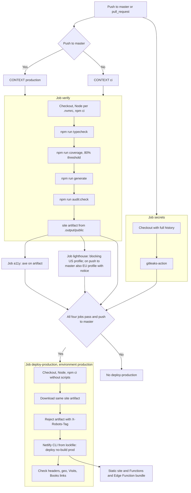

# Deployment

- CI (`.github/workflows/ci.yml`) runs typecheck, tests with coverage, generate, and audit:check, plus gitleaks, axe, and Lighthouse (`deploy-production` waits for all).
- Only a push to master deploys (`deploy-production`, Netlify CLI with `--no-build`). That job checks out the repo and runs `npm ci --ignore-scripts` so Netlify bundles the `/geo` Edge Function and functions from `netlify/functions` (`netlify.toml` → `[functions]`). It then checks production headers, that `/geo` returns `{country}` with `no-store` and rejects POST (405), that `/api/visits/{1d,7d,30d}` is served by the function (`x-visits-source`) with the report for its range, and that `/en/books` and `/es/libros` return 200 with `og:image`.
- Netlify never builds: `netlify.toml` has no build command and `ignore = "exit 0"`, so any build Netlify would start from Git (auto-build, deploy preview) is skipped even if continuous deployment were switched on by mistake. Netlify automatic builds are also disabled in the UI (confirmed by Maurizio, 2026-11-07). Only GitHub Actions publishes.
- `netlify-cli` and `@lhci/cli` come from `package-lock.json` (exact devDependencies): the deploy step runs `npx --no-install netlify deploy …`, which fails rather than downloading a copy.
- The GitHub `production` environment can require manual approval (Settings → Environments) without changing the workflow.

## CI and deployment flow



Sources: [workflow](../.github/workflows/ci.yml), [package.json](../package.json), [netlify.toml](../netlify.toml).
axe, Lighthouse, and coverage details: [quality.md](quality.md); permissions and secrets: [security.md](security.md).
Artifacts are kept seven days and deploy concurrency does not cancel a deploy in progress.
**Limit:** declaring `environment: production` allows external rules, but the YAML does not prove manual approval or branch protection exists.

## Docker

```sh
docker compose up --build -d --wait
# http://localhost:8080/en/ or /es/
docker compose down
```

Without Compose: `docker build -t my-cv:local .`, then `docker run --rm --read-only --cap-drop ALL --security-opt no-new-privileges -p 127.0.0.1:8080:8080 my-cv:local`.

- **Local only:** host port binds to `127.0.0.1`, not the LAN. Compose limits RAM/CPU/PIDs to 256 MiB/1/64; CI checks the limits and records usage.
- **Image:** multi-stage, digest-pinned Node 24 Alpine and Dockerfile frontend. Runtime contains static files and the dependency-free server; UID/GID `10001:10001`, root-owned non-writable content, read-only filesystem and `/en/` healthcheck.
- **Configuration:** none required. Compose forwards only fixed `PORT=8080` and optional `${GEO_COUNTRY:-}` from the shell or gitignored `.env`; GA/Netlify credentials are never injected. `.env.example` separates external tooling variables; use your own values. Runtime settings cannot change a static build. Credentials, snapshots and local artifacts are excluded from the build context; never pass secrets as build arguments.
- **Behaviour:** generated security/cache headers, CSP hashes and noindex are retained; missing/incomplete critical headers fail startup. Existing root language redirects work; unsupported rules fail startup. Analytics is disabled; `/geo` returns unknown country unless simulated. Visits uses labeled sample data. Real GA4 needs your own [Netlify setup](ga4.md#one-time-setup); Functions/Blobs/schedules/edge rate limits are not hosted here.
- **Server:** symlinks (including 404 and metadata) stay within the real document root. Keep content immutable; do not mount attacker-writable trees (no race-safety guarantee). Encoding quality/exclusions cover Brotli/gzip/identity; unexpected errors return generic 500s and shutdown drains for at most five seconds.
- **Maintenance:** CI builds with GHA cache, verifies startup/hardening and scans with cached, SHA/version-pinned Trivy (five-minute timeout): fixable HIGH/CRITICAL OS/library vulnerabilities fail. No exceptions; future exceptions require reason and expiry ([policy](security.md)). Dependabot proposes weekly Docker/Actions updates. No image publication or production-gate changes.
