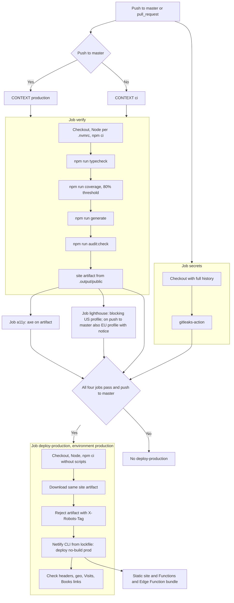

# Deployment

- CI (`.github/workflows/ci.yml`) runs typecheck, tests with coverage, generate, and audit:check, plus gitleaks, axe, and Lighthouse (`deploy-production` waits for all).
- Only a push to master deploys (`deploy-production`, Netlify CLI with `--no-build`). That job checks out the repo and runs `npm ci --ignore-scripts` so Netlify bundles the `/geo` Edge Function and functions from `netlify/functions` (`netlify.toml` → `[functions]`). It then checks production headers, that `/geo` returns `{country}` with `no-store` and rejects POST (405), that `/api/visits/{1d,7d,30d}` is served by the function (`x-visits-source`) with the report for its range, and that `/en/books` and `/es/libros` return 200 with `og:image`.
- Netlify never builds: `netlify.toml` has no build command and `ignore = "exit 0"`, so any build Netlify would start from Git (auto-build, deploy preview) is skipped even if continuous deployment were switched on by mistake. Netlify automatic builds are also disabled in the UI (confirmed by Maurizio, 2026-11-07). Only GitHub Actions publishes.
- `netlify-cli` and `@lhci/cli` come from `package-lock.json` (exact devDependencies): the deploy step runs `npx --no-install netlify deploy …`, which fails rather than downloading a copy.
- The GitHub `production` environment can require manual approval (Settings → Environments) without changing the workflow.

## CI and deployment flow

Sources: [workflow](../.github/workflows/ci.yml), [package.json](../package.json), [netlify.toml](../netlify.toml).
axe, Lighthouse, and coverage details: [quality.md](quality.md); permissions and secrets: [security.md](security.md).
Artifacts are kept seven days and deploy concurrency does not cancel a deploy in progress.
**Limit:** declaring `environment: production` allows external rules, but the YAML does not prove manual approval or branch protection exists.

## Docker

- `docker compose up --build -d --wait` → <http://localhost:8080/en/> or `/es/`; stop with `docker compose down`. Compose ≥2.24 supports the optional `.env` file.
- Without Compose: `docker build -t my-cv:local .` then `docker run --rm --read-only --cap-drop ALL --security-opt no-new-privileges -p 8080:8080 my-cv:local`.
- Multi-stage, digest-pinned Node 24 Alpine build; runtime includes only static files and the dependency-free server, runs as `node`, and healthchecks `/en/`. CI builds with a GitHub Actions cache and checks startup, routes, redirects, headers and sample JSON; it never publishes an image or changes production gates.
- Generated `_headers` (including CSP hashes, caching and **noindex**) are applied. Existing `_redirects` root language rules are supported; unsupported new rules fail startup. Local builds disable analytics. `/geo` returns unknown country by default (`GEO_COUNTRY` can simulate one), not real IP geolocation.
- Visits works with labeled **sample data**. Netlify Functions, Blobs, schedules, rate limits and Edge infrastructure are not hosted by Docker. For real GA4, use your own Netlify site and credentials: [GA4 setup](ga4.md#one-time-setup). Runtime `GA_*` values do not enable it, and real snapshots must not be baked into the image.
- No configuration is required. `.env.example` lists optional variables with blank placeholders; copy to gitignored `.env` only when needed and replace values with your own. `.env*`, keys, snapshots, dependencies, Git history and test artifacts are excluded from the build context. Never pass credentials as build arguments or commit them. Build-time settings are fixed in the Dockerfile; runtime environment cannot rewrite generated assets. Existing CV content/public links remain unchanged.
