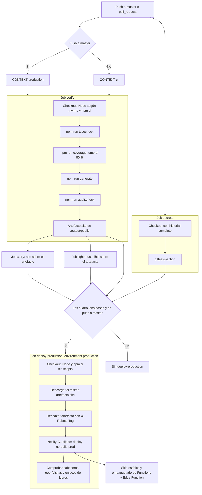

# Despliegue

- La CI (`.github/workflows/ci.yml`) ejecuta typecheck, tests con cobertura, generate y audit:check, más gitleaks, axe y Lighthouse (`deploy-production` espera a todos).
- Solo un push a master despliega (`deploy-production`, Netlify CLI con `--no-build`). Ese job hace checkout del repo y `npm ci --ignore-scripts` para que Netlify empaquete la Edge Function `/geo` y las funciones de `netlify/functions` (`netlify.toml` → `[functions]`). Después comprueba las cabeceras de producción, que `/geo` responde `{country}` con `no-store` y rechaza POST (405), que `/api/visits/{1d,7d,30d}` lo sirve la función (`x-visits-source`) con el informe de su rango, y que `/en/books` y `/es/libros` responden 200 con `og:image`.
- Netlify, si construye él (`netlify.toml`), ejecuta `npm run test && npm run generate`: si falla un test, no hay deploy. La compilación automática de Netlify está desactivada (confirmado por Maurizio, 2026-11-07), así que en la práctica solo publica GitHub Actions.
- El environment `production` de GitHub permite exigir aprobación manual (Settings → Environments) sin tocar el workflow.

## Flujo de la CI y el despliegue

Fuentes: [workflow](../.github/workflows/ci.yml), [package.json](../package.json), [netlify.toml](../netlify.toml).
Detalle de axe, Lighthouse y cobertura: [calidad.md](calidad.md); permisos y secretos: [seguridad.md](seguridad.md).
Los artefactos se guardan siete días y la concurrencia del deploy no cancela un despliegue en curso.
**Límite:** declarar `environment: production` permite reglas externas, pero el YAML no demuestra que haya aprobación manual ni protección de rama.
