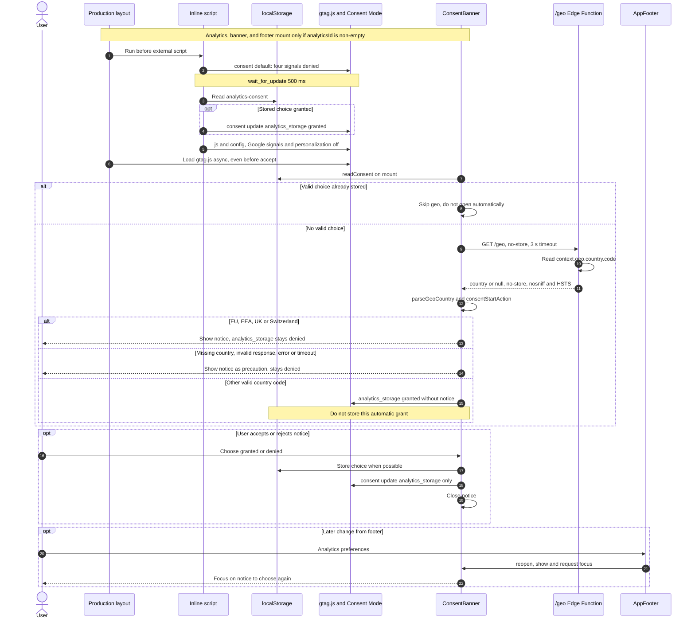

# Features

Detail for each part of the site. Overview in the [README](../README.md).

## Visits (`/visits`)

- Page with Chart.js (loaded only on that page) and filter 1 day / 1 week / 1 month / **Sample data** (radiogroup with arrows, four 44 px buttons fitting at 360 px). Each chart has a tabular alternative.
- Default filter (`lib/visitsFilter.ts`, pure logic with tests): with real data (`sample: false`, GA4 snapshot) **1 month**; if `/api/visits/30d` fails, does not meet minimum contract, or only returns mock (`sample: true`), **Sample data**. If 1 day / 1 week is chosen with API down, show error notice with «Reintentar».
- «Sample data» does not call the API: `buildMockReport('30d')` is built in the browser and loaded lazily (own ~2 KB chunk, only when that filter is chosen).
- Note below filter (icon + text, not color alone): «Datos actualizados hace X h/min» with real data (`generatedAt`, `lib/updatedAgo.ts`); «Ejemplo con datos ficticios: no son visitas reales» if sample is chosen while real data exists; «Aún no hay datos reales: se muestra un ejemplo con datos ficticios» if there is none.
- Single real/sample source of truth: report field `sample` → `visitsNote` (`lib/visitsFilter.ts`) → `useVisitsNote`, used by the page and Home «Visitas» card. The card says «Datos actualizados hace X · solo agregados, sin IPs ni identificadores» with real data and «Datos de ejemplo (mock) · …» with mock.
- Contract: `lib/visitsSchema.ts` (zod, on server). On client, `app/composables/useVisits.ts` requests `/api/visits/{1d,7d,30d}` (same origin, CSP `connect-src 'self'`), minimal check without zod (`isUsableReport`), and **does not know data origin**. Home «Visitas» card uses the 30-day report in SVG.
- With very little data (e.g. 15 visits, zero series, one country, nearly empty heatmap) charts do not break: line uses `monotone` interpolation (does not go below 0) and device ring does not draw borders with a single segment.
- Real GA4 data (snapshot every 3 h), setup, and local testing: [ga4.md](ga4.md).

## Analytics and consent (production only)

- Google Analytics with Consent Mode v2 (`lib/analytics.ts`): all `denied` by default with 500 ms `wait_for_update`, choice stored in `localStorage["analytics-consent"]`.
- Notice shown only in EU/EEA, United Kingdom, and Switzerland (list `CONSENT_BANNER_COUNTRIES` in `lib/consentRegion.ts`). Country from Edge Function `netlify/edge-functions/geo.ts` at `/geo` (`{ "country": "ES" }`, `Cache-Control: no-store`, HSTS, same origin; GET/HEAD only, else 405).
- With stored choice, that choice wins. Without it: country in zone, unknown, or `/geo` error (also locally) → notice; outside zone → `analytics_storage` granted without notice and nothing stored.
- Notice links («Detalles de privacidad») to privacy page `/privacy` (not in menu; copy in `i18n/locales`, periods in `lib/privacy.ts`: 14-month GA retention, same as Admin → Data retention). Footer has «Preferencias de analítica» to reopen the notice and change choice (granted ↔ denied), and «Privacidad».

### Notice and Consent Mode flow



Sources: [Nuxt config](../nuxt.config.ts), [layout](../app/layouts/default.vue),
[analytics](../lib/analytics.ts), [region](../lib/consentRegion.ts),
[Edge Function](../netlify/edge-functions/geo.ts), [banner](../app/components/ConsentBanner.vue),
[shared state](../app/composables/useConsentBanner.ts), [footer](../app/components/AppFooter.vue).

- Outside production `analyticsId` is empty: analytics, notice, and footer (`AppFooter`) do not mount.
- Updates only change `analytics_storage`: accept does not grant ad permissions.
- Region: EU27 + Iceland, Liechtenstein, Norway, United Kingdom, and Switzerland. `parseGeoCountry` normalizes to uppercase and requires two letters, not a full ISO catalog.
- Country comes from edge context (not browser geolocation), is not stored, and `/geo` does not add CORS. Off Netlify the route may be missing and counts as unknown country. Request headers are never read; the visitor can still influence Netlify's own lookup (see [security.md](security.md)), which only changes their own notice. `/geo` has a per-IP rate limit (60/min); a 429 counts as unknown country → notice.
- Notice stays closed while country resolves; `wait_for_update` (500 ms) and `/geo` timeout (3 s) can expire at different times.
- **Limit:** `denied` does not mean zero requests to Google. gtag.js loads and configures before decision and Consent Mode can measure without cookies; do not describe as full block. Revoke does not explicitly clear existing cookies. If `setItem` fails, choice applies only for current visit.

## Opt-in animations

- By default the whole site loads static (final state visible). Header button (`AnimationsToggle`), between links and ES/EN, is the only thing that may move on load.
- Desktop (≥ 1024 px): icon + text. Tablet and mobile: 44×44 icon with tooltip. OFF = amber and play («Activar animaciones»); ON = neutral and pause («Desactivar animaciones»). No `aria-pressed`: `aria-label` is the action copy.
- Preference in `localStorage["animations"]` (`on` | `off`). No choice = OFF. Legacy key `motion` is ignored. Inline script sets `<html data-motion>` before paint (`lib/animations.ts`); ON → `full`, OFF → `reduced`.
- On load, `prefers-reduced-motion` wins: with PRM active site stays OFF even if `on` is stored. Click «Activar» animates current document and does not survive reload (ADR-016).
- When enabled without reload: visible charts `reset` + `update`; journey scenes (Profile) catch up to current progress in 450 ms without moving scroll. When disabled, everything jumps to final state.
- Three soft button pulses as soon as it mounts (3 × 800 ms, no wait): button grows slightly (44 px → ~47 px) and ring widens. Ring reuses Visits CTA `::after` (`.cta-halo`) and paints with `--ui-secondary`, OFF button amber, which already contrasts in light and dark. Only first tab session with no choice and no PRM (`sessionStorage["animations-hint"]`). Stops on button click or focus, on tab hide (`visibilitychange`), or after 3 cycles. Scroll and taps outside do not stop them.

## Home card micro-animations

- Scroll-linked, no loop: draw on enter, reverse on scroll up. Only animate `transform`, `opacity`, and `stroke-dashoffset`.
- Profile: content visible from load (never hidden); on scroll, eyebrow, headline, tagline, and KPI settle in staggered steps (only `translate`/`scale`) and counters rise. Name (`h1`, LCP) is not animated.
- Skills, Experience, Education, and Projects have a full-width SVG scene under the title (`JourneyScene`, `<figure aria-hidden="true">`, viewBox 280×100): 336×120 on desktop, 224×80 centered on mobile (`block-size: clamp(80px, 5.5vw + 58px, 120px)`; 64 px if viewport height under 640). Does not narrow title or cover text.
  - Skills: radar deploys with bounce, 6 staggered bars, amber flash on Front End (`skillProfile` levels).
  - Experience: 5-node path with trail; each node jumps when line reaches it and final milestone emits amber wave.
  - Education: 4 steps rise and mortarboard drops, bounces once, tassel sways.
  - Projects: code types with fixed amber cursor (no blink), «deploy» arrow, 3 blocks stack with check.
  - Geometry, segments, and values in `lib/journeyScene.ts`: each part has channels (`x`, `y`, `scale`, `scaleY`, `rotate`, `opacity`, `offset`) at neutral value at p = 1, so SVG without variables is already final state. Colors: `--g-main` (brand), `--g-acc` (`--accent`, amber), `--g-track` (guides, #6E7681 / #8C959F), and tinted decorative fill (contrast from border: main and acc ≥ 4.5:1, guides ≥ 3:1).
  - First paint without flash: each channel reads as `var(--fx-<part>-<channel>, <value at p = 0>)` (`sceneVariableReference`). Rules apply only with `<html data-motion="full">` (animation on): no JS or animations off → final state.
- Visits card has no micro-animation (its own scroll-linked drawing).
- Pure logic in `lib/cardMotion.ts` (per-card progress and Profile values) and `lib/journeyScene.ts` (scenes), with tests, on `lib/easing.ts`. `app/composables/useCardMotion.ts` writes CSS variables `--fx-*` in the same rAF as journey (`useJourney`, `onFrame` option).
- Progress: on fixed journey (desktop/tablet) from segment point (0.6–0.85 of segment; Profile 0–0.25). On mobile pin, 0.46–0.62 (Profile follows hologram entry). Without pin, from card position on screen.
- Animations off: static final state, no jumps (no variables, each channel at final value). Keyboard focus inside a card also forces final state. Mid-page enable: catch-up 0 to `pLive` in 450 ms.

## Light / dark theme (dark by default)

- Header sun/moon button (`UColorModeButton` from Nuxt UI, uses `@nuxtjs/color-mode`). Config in `nuxt.config.ts` (`colorMode`: `preference` and `fallback` = `dark`); constants and pure logic in `lib/theme.ts`.
- **Decision:** without stored choice, dark. `prefers-color-scheme` is **not** read: only explicit choice with the button (`localStorage["nuxt-color-mode"]` = `light` | `dark`) changes theme, persisted across pages and locales. `system` saved by color-mode on old visits is not a choice: removed and reverts to dark.
- No flash: prerendered HTML already has `<html class="dark">` and `<meta name="theme-color" content="#0d1117">` (also without JS). Inline script `THEME_NO_FLASH_SCRIPT` (before color-mode script) only removes `dark` if `light` is stored; its hash is in CSP via `scripts/build-headers.mjs`. `color-scheme` (scrollbars and native controls) and `theme-color` follow theme.
- Does not affect `og-cv.png` or PDFs (their own template).

## Books I recommend

- Profile section after journey (`#books`, no menu entry). Data in `data/` (`books` in `cv.shared.ts` and copy in `cv.en.ts` / `cv.es.ts`); WebP covers in `public/books/` with real dimensions (a test checks).
- Short links `/en/books` and `/es/libros` for LinkedIn highlights (strips `#`): paste `https://www.mauriziorendon.com/en/books` (or `/es/libros`). Minimal page (`app/pages/books.vue`, translated routes in `nuxt.config.ts` → `i18n.pages`) returns **200** with same preview as Profile (`og:title`, `og:description`, `og:image`, `twitter:card`; `usePageSeo` with `canonicalPath`: `canonical` and `og:url` to Profile, no `hreflang`, no `noindex`) and jumps to `/en/#books` (or `/es/#books`) with `location.replace` (inline script with CSP hash via `scripts/build-headers.mjs`) and `<meta http-equiv="refresh">` without JS; visible link is fallback. No Nuxt scripts (`routeRules` → `noScripts`) or `_payload.json`.
- Prerendered as `en/books.html` and `es/libros.html` (hook `prerender:generate`, `lib/booksShortLink.ts`): Netlify serves `path.html` with 200 at `/path` and sends `/path/` to `/path` (301), while `path/index.html` would 301 to `/path/`. No rules in `_redirects`: previous 301 with fragment (`/en/#books`) failed LinkedIn Post Inspector (500), and a trailing-slash rule could loop (Netlify matches with or without). Tests: `tests/unit/booksShortLink.spec.ts` and `redirects.spec.ts`. Check: `curl -A LinkedInBot -i https://www.mauriziorendon.com/en/books` → 200 with `og:image`.

## Share preview (Open Graph / Twitter)

`usePageSeo` is the single point: all pages (EN/ES) have absolute `og:image` (`https://www.mauriziorendon.com/og-cv.png`, 1200×630 PNG, translated `alt` in `seo.imageAlt`), `og:url`/`og:locale` from `useLocaleHead` (same URL as `canonical` and `hreflang`) and `twitter:card=summary_large_image`. Constants in `lib/socialMeta.ts`.

Image from `scripts/og-image.mjs` (blue from `--color-brand-*` tokens in `main.css`, local Inter and Space Grotesk, avatar `public/me.webp`; no contact data). To regenerate, with Google Chrome installed (or `CHROME_PATH=/path/to/browser`):

```sh
npm i --no-save playwright-core && node scripts/og-image.mjs
```
