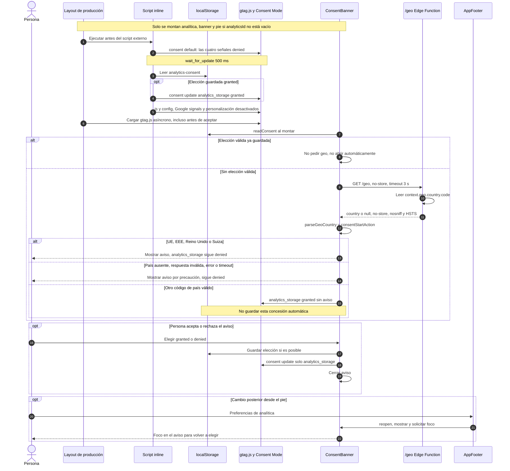

# Funcionalidades

Detalle de cada parte de la web. Visión general en el [README](../README.md).

## Visitas (`/visits`)

- Página con Chart.js (solo se carga en esa página) y filtro 1 día / 1 semana / 1 mes / **Datos de ejemplo** (radiogroup con flechas, 4 botones de 44 px que caben a 360 px). Cada gráfica tiene tabla alternativa.
- Filtro por defecto (`lib/visitsFilter.ts`, lógica pura con tests): con datos reales (`sample: false`, instantánea de GA4) **1 mes**; si `/api/visits/30d` falla, no cumple el contrato mínimo o solo devuelve el mock (`sample: true`), **Datos de ejemplo**. Si se elige 1 día / 1 semana con la API caída, sale el aviso de error con «Reintentar».
- «Datos de ejemplo» no pide nada a la API: `buildMockReport('30d')` se genera en el navegador y se carga en diferido (chunk propio de ~2 KB, solo al elegir ese filtro).
- Nota bajo el filtro (icono + texto, no solo color): «Datos actualizados hace X h/min» con datos reales (`generatedAt`, `lib/updatedAgo.ts`); «Ejemplo con datos ficticios: no son visitas reales» si se elige el ejemplo habiendo datos reales; «Aún no hay datos reales: se muestra un ejemplo con datos ficticios» si no los hay.
- Una sola fuente de verdad real/ejemplo: el campo `sample` del informe → `visitsNote` (`lib/visitsFilter.ts`) → `useVisitsNote`, que usan la página y la tarjeta «Visitas» del Inicio. La tarjeta dice «Datos actualizados hace X · solo agregados, sin IPs ni identificadores» con datos reales y «Datos de ejemplo (mock) · …» con el mock.
- Contrato: `lib/visitsSchema.ts` (zod, en el servidor). En el cliente, `app/composables/useVisits.ts` pide `/api/visits/{1d,7d,30d}` (mismo origen, CSP `connect-src 'self'`), hace una comprobación mínima sin zod (`isUsableReport`) y **no sabe de dónde salen los datos**. La tarjeta «Visitas» del Inicio usa el informe de 30 días en SVG.
- Con muy pocos datos (p. ej. 15 visitas, series con ceros, un solo país, heatmap casi vacío) las gráficas no se rompen: la línea usa interpolación `monotone` (no baja de 0) y el anillo de dispositivos no pinta bordes con un solo segmento.
- Datos reales de GA4 (instantánea cada 3 h), puesta en marcha y pruebas en local: [ga4.md](ga4.md).

## Analítica y consentimiento (solo en producción)

- Google Analytics con Consent Mode v2 (`lib/analytics.ts`): todo `denied` por defecto con `wait_for_update` de 500 ms, y la elección se guarda en `localStorage["analytics-consent"]`.
- El aviso solo se muestra en la UE/EEE, Reino Unido y Suiza (lista `CONSENT_BANNER_COUNTRIES` en `lib/consentRegion.ts`). El país lo da la Edge Function `netlify/edge-functions/geo.ts` en `/geo` (`{ "country": "ES" }`, `Cache-Control: no-store`, HSTS, mismo origen; solo GET/HEAD, el resto da 405).
- Con elección guardada, manda esa elección. Sin ella: país de la zona, desconocido o error de `/geo` (también en local) → aviso; fuera de la zona → `analytics_storage` concedido sin aviso y sin guardar nada.
- El aviso enlaza («Detalles de privacidad») a la página de privacidad `/privacy` (fuera del menú; textos en `i18n/locales`, plazos en `lib/privacy.ts`: retención de GA de 14 meses, igual que en Admin → Retención de datos). En el pie están «Preferencias de analítica», que reabre el aviso para cambiar la elección (granted ↔ denied), y «Privacidad».

### Flujo del aviso y Consent Mode



Fuentes: [configuración Nuxt](../nuxt.config.ts), [layout](../app/layouts/default.vue),
[analytics](../lib/analytics.ts), [región](../lib/consentRegion.ts),
[Edge Function](../netlify/edge-functions/geo.ts), [banner](../app/components/ConsentBanner.vue),
[estado compartido](../app/composables/useConsentBanner.ts), [pie](../app/components/AppFooter.vue).

- Fuera de producción `analyticsId` queda vacío: no se montan analítica, aviso ni pie (`AppFooter`).
- Las actualizaciones solo cambian `analytics_storage`: aceptar no concede permisos publicitarios.
- Región: UE27 + Islandia, Liechtenstein, Noruega, Reino Unido y Suiza. `parseGeoCountry` normaliza a mayúsculas y exige dos letras, sin catálogo ISO completo.
- El país sale del contexto del borde (no de la geolocalización del navegador), no se almacena y `/geo` no añade CORS. Fuera de Netlify la ruta puede no existir y cuenta como país desconocido.
- El aviso sigue cerrado mientras se resuelve el país; `wait_for_update` (500 ms) y el timeout de `/geo` (3 s) pueden vencer en momentos distintos.
- **Límite:** `denied` no significa cero solicitudes a Google. gtag.js se carga y configura antes de decidir y Consent Mode puede medir sin cookies; no debe describirse como bloqueo completo. Revocar no borra explícitamente cookies existentes. Si falla `setItem`, la elección vale solo para la visita actual.

## Animaciones opt-in

- Por defecto todo el sitio carga estático (estado final visible). El botón de la cabecera (`AnimationsToggle`), entre los enlaces y ES/EN, es lo único que puede moverse al cargar.
- Escritorio (≥ 1024 px): icono + texto. Tablet y móvil: icono 44×44 con tooltip. OFF = ámbar y play («Activar animaciones»); ON = neutro y pausa («Desactivar animaciones»). Sin `aria-pressed`: el `aria-label` es el copy de la acción.
- Preferencia en `localStorage["animations"]` (`on` | `off`). Sin elección = OFF. La clave antigua `motion` se ignora. Un script inline fija `<html data-motion>` antes de pintar (`lib/animations.ts`); ON → `full`, OFF → `reduced`.
- Al cargar, `prefers-reduced-motion` manda: con PRM activo la web queda OFF aunque haya `on` guardado. Un clic en «Activar» anima en el documento actual y no sobrevive a una recarga (ADR-016).
- Al activar sin recargar: las gráficas visibles hacen `reset` + `update`; las escenas del recorrido (Profile) alcanzan su progreso actual en 450 ms sin mover el scroll. Al desactivar, todo salta al estado final.
- Tres pulsos suaves del botón (2,4 s tras 600 ms) solo en la primera sesión de pestaña sin elección y sin PRM (`sessionStorage["animations-hint"]`).

## Microanimaciones de las tarjetas del Inicio

- Ligadas al scroll y sin bucle: se dibujan al entrar y vuelven atrás al subir. Solo animan `transform`, `opacity` y `stroke-dashoffset`.
- Perfil: su contenido se ve desde la carga (nunca se oculta); con el scroll, eyebrow, titular, tagline y KPI se asientan escalonados (solo `translate`/`scale`) y los contadores suben. El nombre (`h1`, LCP) no se anima.
- Habilidades, Experiencia, Formación y Proyectos llevan una escena SVG a ancho completo bajo el título (`JourneyScene`, `<figure aria-hidden="true">`, viewBox 280×100): 336×120 en escritorio, 224×80 centrada en móvil (`block-size: clamp(80px, 5.5vw + 58px, 120px)`; 64 px si la ventana mide menos de 640 de alto). No reduce el ancho del título ni tapa texto.
  - Habilidades: radar que se despliega con rebote, 6 barras escalonadas y destello ámbar en Front End (niveles de `skillProfile`).
  - Experiencia: trayectoria de 5 nodos con estela; cada nodo salta al llegarle la línea y el hito final emite una onda ámbar.
  - Formación: 4 escalones que se elevan y un birrete que cae, rebota una vez y balancea la borla.
  - Proyectos: código que se teclea con cursor ámbar fijo (sin parpadeo), flecha «deploy» y 3 bloques que se apilan con check.
  - Geometría, tramos y valores en `lib/journeyScene.ts`: cada parte tiene canales (`x`, `y`, `scale`, `scaleY`, `rotate`, `opacity`, `offset`) que valen su valor neutro en p = 1, así el SVG sin variables ya es el estado final. Colores: `--g-main` (brand), `--g-acc` (`--accent`, ámbar), `--g-track` (guías, #6E7681 / #8C959F) y relleno tintado decorativo (el contraste lo da el borde: main y acc ≥ 4,5:1, guías ≥ 3:1).
  - Primer pintado sin parpadeo: cada canal se lee como `var(--fx-<parte>-<canal>, <valor en p = 0>)` (`sceneVariableReference`). Esas reglas solo aplican con `<html data-motion="full">` (animación activada): sin JS o con animaciones apagadas, estado final.
- La tarjeta de Visitas no lleva microanimación (tiene su propio dibujo ligado al scroll).
- Lógica pura en `lib/cardMotion.ts` (progreso por tarjeta y valores del Perfil) y `lib/journeyScene.ts` (escenas), con tests, sobre `lib/easing.ts`. `app/composables/useCardMotion.ts` escribe variables CSS `--fx-*` en el mismo rAF del recorrido (`useJourney`, opción `onFrame`).
- Progreso: en el recorrido fijado (escritorio/tablet) sale del tramo del punto (0,6–0,85 del segmento; el Perfil, 0–0,25). En el pin móvil, 0,46–0,62 (el Perfil sigue la entrada del holograma). Sin pin, se calcula por la posición de la tarjeta en pantalla.
- Animaciones apagadas: estado final estático, sin saltos (sin variables, cada canal vale su valor final). El foco de teclado dentro de una tarjeta también fuerza el estado final. Al activar a mitad de página, catch-up de 0 a `pLive` en 450 ms.

## Tema claro / oscuro (oscuro por defecto)

- Botón sol/luna de la cabecera (`UColorModeButton` de Nuxt UI, que usa `@nuxtjs/color-mode`). Configuración en `nuxt.config.ts` (`colorMode`: `preference` y `fallback` = `dark`); constantes y lógica pura en `lib/theme.ts`.
- **Decisión:** sin elección guardada, oscuro. `prefers-color-scheme` **no** se consulta: solo una elección explícita con el botón (`localStorage["nuxt-color-mode"]` = `light` | `dark`) cambia el tema, y se mantiene en todas las páginas e idiomas. El valor `system` que guardaba color-mode a visitas antiguas no es una elección: se borra y se vuelve al oscuro.
- Sin parpadeo: el HTML prerenderizado ya sale con `<html class="dark">` y `<meta name="theme-color" content="#0d1117">` (también sin JS). El script inline `THEME_NO_FLASH_SCRIPT` (antes del de color-mode) solo quita `dark` si hay `light` guardado; su hash entra en la CSP con `scripts/build-headers.mjs`. `color-scheme` (barras de scroll y controles nativos) y `theme-color` siguen al tema.
- No afecta a `og-cv.png` ni a los PDF (tienen su propia plantilla).

## Libros que recomiendo

- Sección del Perfil tras el recorrido (`#books`, sin entrada en el menú). Datos en `data/` (`books` en `cv.shared.ts` y textos en `cv.en.ts` / `cv.es.ts`); portadas WebP en `public/books/` con sus medidas reales (un test lo comprueba).
- Enlaces cortos `/en/books` y `/es/libros` para Destacados de LinkedIn (que quita el `#`): pega `https://www.mauriziorendon.com/en/books` (o `/es/libros`). Son una página mínima (`app/pages/books.vue`, rutas traducidas en `nuxt.config.ts` → `i18n.pages`) que responde **200** con la misma vista previa que el Perfil (`og:title`, `og:description`, `og:image`, `twitter:card`; `usePageSeo` con `canonicalPath`: `canonical` y `og:url` al Perfil, sin `hreflang`, sin `noindex`) y salta a `/en/#books` (o `/es/#books`) con `location.replace` (script inline con hash en la CSP vía `scripts/build-headers.mjs`) y `<meta http-equiv="refresh">` sin JS; el enlace visible queda de respaldo. Sin scripts de Nuxt (`routeRules` → `noScripts`) ni `_payload.json`.
- Se prerenderizan como `en/books.html` y `es/libros.html` (hook `prerender:generate`, `lib/booksShortLink.ts`): Netlify sirve `ruta.html` con 200 en `/ruta` y manda `/ruta/` a `/ruta` (301), mientras que `ruta/index.html` haría un 301 a `/ruta/`. No hay reglas en `_redirects`: el 301 anterior con fragmento (`/en/#books`) hacía fallar el Post Inspector de LinkedIn (500), y una regla para la barra final podría hacer bucle (Netlify empareja con o sin ella). Tests: `tests/unit/booksShortLink.spec.ts` y `redirects.spec.ts`. Comprobación: `curl -A LinkedInBot -i https://www.mauriziorendon.com/en/books` → 200 con `og:image`.

## Vista previa al compartir (Open Graph / Twitter)

`usePageSeo` es el único punto: todas las páginas (EN/ES) llevan `og:image` absoluta (`https://www.mauriziorendon.com/og-cv.png`, 1200×630 PNG, `alt` traducido en `seo.imageAlt`), `og:url`/`og:locale` de `useLocaleHead` (misma URL que `canonical` y `hreflang`) y `twitter:card=summary_large_image`. Constantes en `lib/socialMeta.ts`.

La imagen sale de `scripts/og-image.mjs` (azul de los tokens `--color-brand-*` de `main.css`, Inter y Space Grotesk locales, avatar `public/me.webp`; sin datos de contacto). Para regenerarla, con Google Chrome instalado (o `CHROME_PATH=/ruta/al/navegador`):

```sh
npm i --no-save playwright-core && node scripts/og-image.mjs
```
