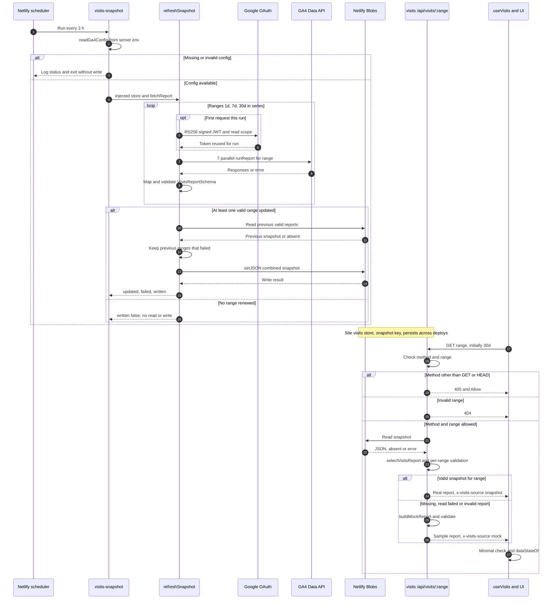
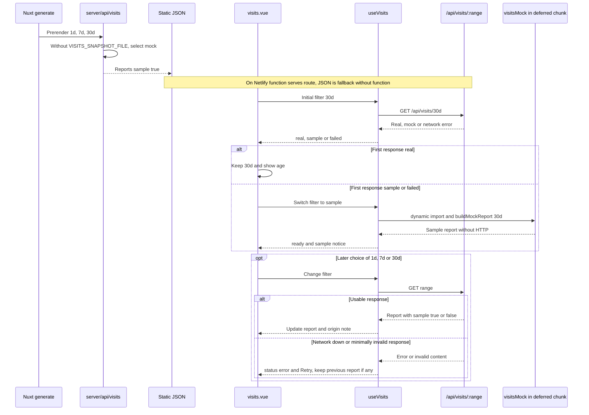

# Visits: real Google Analytics 4 data

Snapshot every 3 h serving `/api/visits/:range`. Page and behavior: [features.md](features.md#visits-visits). Types and schemas: [types.md](types.md).

```
GA4 Data API ──(every 3 h)── netlify/functions/visits-snapshot.ts ──► Netlify Blobs (store «visits», key «snapshot»)
                                                                            │
browser ── GET /api/visits/:range ── netlify/functions/visits.ts ◄────────┘  (if missing or invalid → mock)
```

- `visits-snapshot` (scheduled, `0 */3 * * *` UTC): queries GA4 (`runReport`, 7 reports per range) for 1d, 7d, and 30d, validates each report with zod, and stores all three together. A failing range keeps the previous one; if all fail, nothing is written.
- `visits` serves `/api/visits/:range` on Netlify: snapshot report or, if missing or invalid, `buildMockReport`. Responds with `x-visits-source: snapshot | mock`, 10 min durable CDN cache (`Netlify-CDN-Cache-Control`) whose key ignores the query string (`Netlify-Vary: query=none`), browser always revalidates; per-IP rate limit of 60 requests/min (`config.rateLimit`). Mock JSON remains prerendered as static fallback.
- Code (pure and tested, no network): `lib/googleServiceAccount.ts` (JWT RS256 signed with `node:crypto` → OAuth token; no `google-auth-library`), `lib/visitsGa4.ts` (periods, requests, mapping to contract), `lib/visitsSnapshot.ts` (snapshot and store), `lib/visitsSource.ts` (sources `snapshot` → `mock`; live data only needs a `live` source in front) and `lib/visitsBlobStore.ts` / `lib/visitsFileStore.ts` (Netlify Blobs / local file).
- GA4 → contract mapping:
  - Visits = `sessions`; visitors = `totalUsers`; average duration = `averageSessionDuration`; bounce = `bounceRate`. Each KPI compared to previous period of same length.
  - Periods in full days through yesterday: 1d = yesterday by hour (`dateHour`), vs day before; 7d and 30d = by day (`date`). Today excluded because GA4 has not finished processing. Dates use property timezone.
  - Devices = `deviceCategory` in %; categories not in contract (e.g. «smart tv») dropped.
  - Countries = `countryId`; under 5 visits or «(not set)» go to «Otros».
  - Sources = `sessionDefaultChannelGroup`: Organic Search, Direct, Referral; LinkedIn by `sessionSource` (linkedin, lnkd.in); rest to «Otros».
  - Pages = `screenPageViews` by `pagePath` without locale prefix (`/es/x` and `/en/x` summed), top 6, **only allowlisted site paths** (`REPORTED_PAGE_PATHS` in `lib/visits.ts`; the schema enforces the same list, so spam or unknown paths never reach the public JSON). **Deviation:** CV PDF from mock does not appear because GA4 counts downloads as events, not page views.
  - Hours = `dayOfWeek` × `hour` in 3 h buckets, Monday to Sunday.

## One-time setup

1. Google Cloud: create a project (or use one), enable **Google Analytics Data API**, create a **service account** with no project roles, and create a **JSON** key.
2. GA4 → Admin → Property access management → add service account email (`…@….iam.gserviceaccount.com`) with **Viewer** role. Nothing more needed.
3. Netlify → Site configuration → Environment variables, scope **Functions**, marked secret:
   - `GA_PROPERTY_ID`: property **numeric** ID (Admin → Property details). Not the `G-…` measurement ID.
   - `GA_SERVICE_ACCOUNT_JSON`: full key JSON content.
4. Deploy (push to master). First snapshot on the next hour divisible by 3 (UTC). To skip waiting: Netlify → Functions → `visits-snapshot` → **Run now**, and check its logs.

Credentials live only in Netlify: never in repo, client, or logs (logs only say which ranges updated and HTTP status from Google).

## Test locally

- Without `GA_*`: `npm run dev` → mock (same as static site).
- With `GA_*` (key in a file outside repo): `GA_PROPERTY_ID=123456789 GA_SERVICE_ACCOUNT_JSON="$(cat ~/path/key.json)" npm run visits:snapshot`. Fetches 3 ranges from GA4 and writes `.data/visits-snapshot.json` (gitignored). Then `VISITS_SNAPSHOT_FILE=.data/visits-snapshot.json npm run dev` serves that file. Do not set `VISITS_SNAPSHOT_FILE` when running `generate`: static JSON must stay mock.
- Netlify functions with Blobs can also be tested with `netlify dev` + `netlify functions:invoke visits-snapshot` (Netlify CLI).

## Limits and quotas

Each run does 21 `runReport` (7 per range, one range at a time because GA4 allows 10 concurrent requests per property). 168 per day, well below standard property quota (200,000 tokens/day and 40,000 per hour; a report like this uses a few tokens). Scheduled function max 30 s. Netlify Blobs and functions are on the Netlify plan; only a few KB JSON is stored and CDN absorbs almost all reads.

## Diagrams

### Production: decoupled refresh and read



Sources: [scheduled job](../netlify/functions/visits-snapshot.ts),
[refreshSnapshot](../lib/visitsSnapshot.ts), [config and shared token](../lib/visitsGa4Config.ts),
[OAuth](../lib/googleServiceAccount.ts), [GA4](../lib/visitsGa4.ts),
[Blobs](../lib/visitsBlobStore.ts), [endpoint](../netlify/functions/visits.ts),
[source selection](../lib/visitsSource.ts).

- Schedule `0 */3 * * *` is evaluated in UTC; in Atlantic/Canary it varies with daylight saving.
- Public endpoint **does not** query GA4 live: `live` exists as a type literal but is not in its source list.
- Partial update keeps previous **valid** reports with no age limit. If Blob write fails, error propagates: no automatic second store.
- A real report with zero visits is still real: page shows empty state, not mock.

### Static fallback, initial filter, and network error



Sources: [Nitro](../server/api/visits/%5Brange%5D.get.ts), [Nuxt](../nuxt.config.ts),
[useVisits](../app/composables/useVisits.ts), [filter](../lib/visitsFilter.ts),
[page](../app/pages/visits.vue), [local store](../lib/visitsFileStore.ts),
[local script](../scripts/visits-snapshot.ts).

- Initial filter decision happens once on the page; a later failure does not switch to «Sample data» alone.
- **Time limit:** `visitsPeriods` computes days through yesterday in UTC, while GA4 interprets dates in property timezone, which code does not read.
