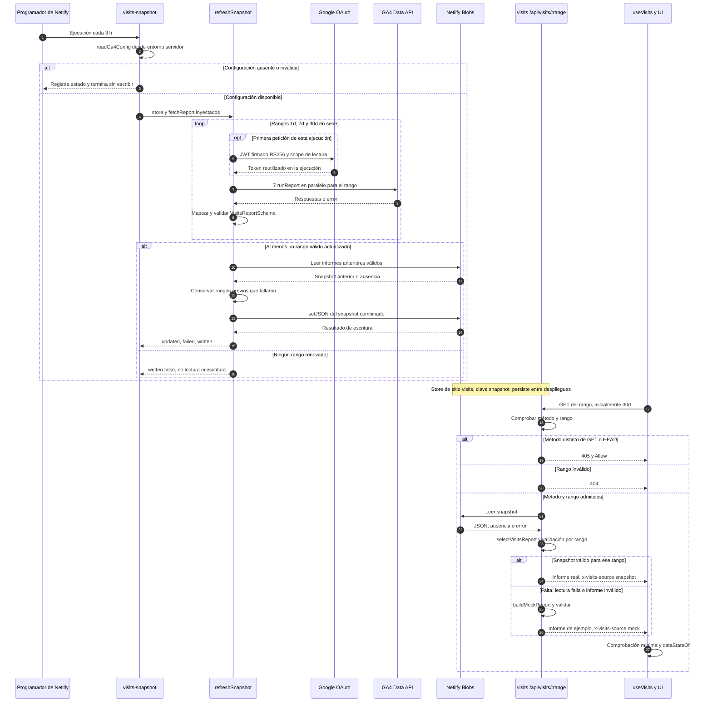
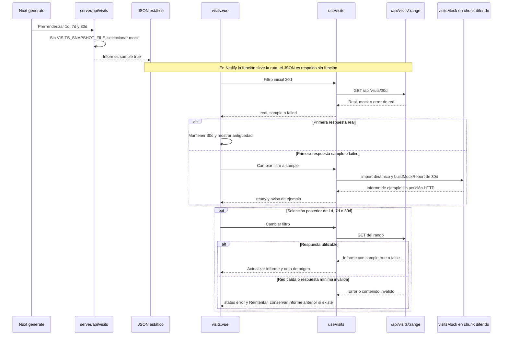

# Visitas: datos reales de Google Analytics 4

Instantánea cada 3 h que sirve `/api/visits/:range`. La página y su comportamiento: [funcionalidades.md](funcionalidades.md#visitas-visits). Tipos y esquemas: [tipos.md](tipos.md).

```
GA4 Data API ──(cada 3 h)── netlify/functions/visits-snapshot.ts ──► Netlify Blobs (store «visits», clave «snapshot»)
                                                                            │
navegador ── GET /api/visits/:range ── netlify/functions/visits.ts ◄────────┘  (si no hay o no es válida → mock)
```

- `visits-snapshot` (programada, `0 */3 * * *` UTC): pide a GA4 (`runReport`, 7 informes por rango) 1d, 7d y 30d, valida cada informe con zod y guarda los tres juntos. Un rango que falla conserva el anterior; si fallan todos, no escribe.
- `visits` sirve `/api/visits/:range` en Netlify: el informe de la instantánea o, si no hay o no es válido, `buildMockReport`. Responde con `x-visits-source: snapshot | mock`, caché de CDN de 10 min (`Netlify-CDN-Cache-Control`) y el navegador siempre revalida. El JSON del mock sigue prerrenderizado como respaldo estático.
- Código (puro y con tests, sin red): `lib/googleServiceAccount.ts` (JWT RS256 firmado con `node:crypto` → token OAuth; sin `google-auth-library`), `lib/visitsGa4.ts` (periodos, peticiones y mapeo al contrato), `lib/visitsSnapshot.ts` (instantánea y almacén), `lib/visitsSource.ts` (fuentes `snapshot` → `mock`; para datos en vivo bastará añadir una fuente `live` delante) y `lib/visitsBlobStore.ts` / `lib/visitsFileStore.ts` (Netlify Blobs / fichero local).
- Mapeo GA4 → contrato:
  - Visitas = `sessions`; visitantes = `totalUsers`; duración media = `averageSessionDuration`; rebote = `bounceRate`. Cada KPI se compara con el periodo anterior de la misma longitud.
  - Periodos en días completos hasta ayer: 1d = ayer por horas (`dateHour`), frente a anteayer; 7d y 30d = por día (`date`). Hoy no se incluye porque GA4 aún no lo ha procesado. Las fechas son las de la zona horaria de la propiedad.
  - Dispositivos = `deviceCategory` en %; categorías que no están en el contrato (p. ej. «smart tv») se descartan.
  - Países = `countryId`; con menos de 5 visitas o «(not set)» van a «Otros».
  - Fuentes = `sessionDefaultChannelGroup`: Organic Search, Direct y Referral; LinkedIn se reconoce por `sessionSource` (linkedin, lnkd.in); el resto va a «Otros».
  - Páginas = `screenPageViews` por `pagePath` sin prefijo de idioma (`/es/x` y `/en/x` suman juntas), las 6 primeras. **Desviación:** el PDF del CV del mock no sale, porque GA4 cuenta las descargas como evento, no como página vista.
  - Horas = `dayOfWeek` × `hour` en franjas de 3 h, de lunes a domingo.

## Puesta en marcha (una vez)

1. Google Cloud: crear un proyecto (o usar uno), activar la **Google Analytics Data API**, crear una **cuenta de servicio** sin roles de proyecto y crearle una clave **JSON**.
2. GA4 → Administrar → Gestión de acceso a la propiedad → añadir el email de la cuenta de servicio (`…@….iam.gserviceaccount.com`) con el rol **Lector**. No necesita más.
3. Netlify → Site configuration → Environment variables, con ámbito **Functions** y marcadas como secretas:
   - `GA_PROPERTY_ID`: ID **numérico** de la propiedad (Administrar → Detalles de la propiedad). No es el `G-…` de medición.
   - `GA_SERVICE_ACCOUNT_JSON`: el contenido completo del JSON de la clave.
4. Desplegar (push a master). La primera instantánea llega en la siguiente hora múltiplo de 3 (UTC). Para no esperar: Netlify → Functions → `visits-snapshot` → **Run now**, y revisar sus registros.

Las credenciales solo viven en Netlify: nunca en el repo, el cliente ni los registros (los registros solo dicen qué rangos se actualizaron y qué estado HTTP dio Google).

## Probar en local

- Sin `GA_*`: `npm run dev` → mock (lo mismo que el sitio estático).
- Con `GA_*` (clave en un fichero fuera del repo): `GA_PROPERTY_ID=123456789 GA_SERVICE_ACCOUNT_JSON="$(cat ~/ruta/clave.json)" npm run visits:snapshot`. Pide los 3 rangos a GA4 y escribe `.data/visits-snapshot.json` (ignorado por git). Después, `VISITS_SNAPSHOT_FILE=.data/visits-snapshot.json npm run dev` sirve ese fichero. No definas `VISITS_SNAPSHOT_FILE` al hacer `generate`: el JSON estático debe seguir siendo el mock.
- Las funciones de Netlify con Blobs también se pueden probar con `netlify dev` + `netlify functions:invoke visits-snapshot` (Netlify CLI).

## Límites y cuotas

Cada ejecución hace 21 `runReport` (7 por rango, un rango cada vez porque GA4 admite 10 peticiones simultáneas por propiedad). Son 168 al día, muy por debajo de la cuota de una propiedad estándar (200.000 tokens/día y 40.000 por hora; un informe así gasta unos pocos tokens). Una función programada puede durar como máximo 30 s. Netlify Blobs y las funciones entran en el plan de Netlify; aquí solo se guarda un JSON de unos KB y la CDN absorbe casi todas las lecturas.

## Diagramas

### Producción: actualización y lectura desacopladas



Fuentes: [tarea programada](../netlify/functions/visits-snapshot.ts),
[refreshSnapshot](../lib/visitsSnapshot.ts), [configuración y token compartido](../lib/visitsGa4Config.ts),
[OAuth](../lib/googleServiceAccount.ts), [GA4](../lib/visitsGa4.ts),
[Blobs](../lib/visitsBlobStore.ts), [endpoint](../netlify/functions/visits.ts),
[selección de fuentes](../lib/visitsSource.ts).

- El horario `0 */3 * * *` se evalúa en UTC; en Atlantic/Canary varía con el horario estacional.
- El endpoint público **no** consulta GA4 en directo: `live` existe como literal de tipo, pero no está en su lista de fuentes.
- La actualización parcial conserva informes anteriores **válidos** sin límite de antigüedad. Si falla la escritura en Blobs, el error se propaga: no hay segundo almacén automático.
- Un informe real con cero visitas sigue siendo real: la página muestra su estado vacío, no el mock.

### Respaldo estático, filtro inicial y error de red



Fuentes: [Nitro](../server/api/visits/%5Brange%5D.get.ts), [Nuxt](../nuxt.config.ts),
[useVisits](../app/composables/useVisits.ts), [filtro](../lib/visitsFilter.ts),
[página](../app/pages/visits.vue), [almacén local](../lib/visitsFileStore.ts),
[script local](../scripts/visits-snapshot.ts).

- La primera decisión de filtro se toma una sola vez en la página; un fallo posterior no cambia solo a «Datos de ejemplo».
- **Límite temporal:** `visitsPeriods` calcula los días hasta ayer en UTC, mientras GA4 interpreta las fechas en la zona de la propiedad, que el código no consulta.
