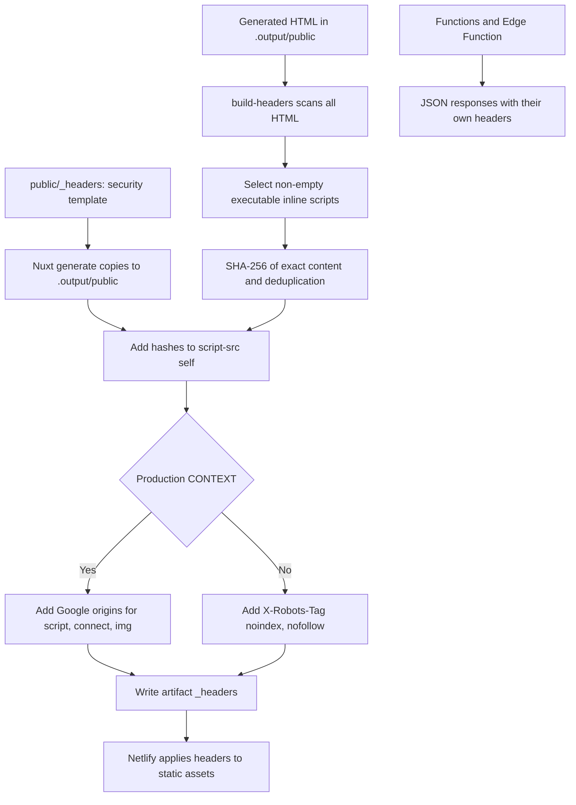

# Security

- Strict CSP in `public/_headers`: inline scripts carry hashes (computed by `scripts/build-headers.mjs` after each `generate`). Only the production build adds Google Analytics (`ANALYTICS_CSP_SOURCES` in `lib/analytics.ts`): `script-src` allows only `https://www.googletagmanager.com` (gtag.js); `connect-src` and `img-src` allow Google measurement origins.
- Conscious exception: `style-src 'unsafe-inline'`, because Nuxt UI and Vue generate inline styles. It affects styles only, not scripts.
- Outside production (`CONTEXT` other than `production` on Netlify) adds `X-Robots-Tag: noindex`.
- Hashed assets under `/_nuxt/` are served with one-year cache and `immutable`.
- GitHub Actions are pinned by commit SHA. Dependabot (`.github/dependabot.yml`) reviews npm and github-actions weekly on the default branch (master): grouped minor/patch, few open PRs, `chore(deps)` commits, no auto-merge.
- `npm run audit:check` (CI) fails on high/critical vulnerabilities except those accepted and justified in `scripts/audit.mjs` (each with `reviewBy`; the list is empty for now). It **fails closed**: if `npm audit` cannot run, is killed, exits with an unexpected code, prints non-JSON, returns an `error` object, or lacks `vulnerabilities`/`metadata`, the check fails instead of passing as a clean audit (`parseAuditReport`, tested in `tests/unit/audit.spec.ts`).
- CI tools that touch the deploy or the audits (`netlify-cli`, `@lhci/cli`) are exact devDependencies pinned by `package-lock.json`: `npm ci` installs them and the workflow runs them with `npx --no-install` / `npm run`, so nothing is downloaded ad hoc next to `NETLIFY_AUTH_TOKEN`. Pinning them surfaced a high advisory in `basic-ftp` (via `@lhci/cli` → `proxy-agent`): `overrides` forces the patched `6.2.6` (same API; 6.0's only breaking change is a safer FTP default).
- Accepted risk, **GHSA-gcqx-w48m-w2h4** (`deepmerge` ≤4.3.1, low, prototype poisoning in `mergeObject()`): no patched release exists. It arrives only through build/CLI tooling (`nuxt` → `nitropack` → `@rollup/plugin-node-resolve`, and `netlify-cli` → `@netlify/config`), merges trusted repo configuration, and is not shipped (`rg -i deepmerge .output/public` finds nothing). Not forked or downgraded (`npm audit fix --force` would propose a Nuxt downgrade). **Review by 2027-02-08** or as soon as upstream publishes a fix; Dismissing the Dependabot alert as tolerable risk is up to the repository owner.
- Visits data: only allowlisted site paths (`REPORTED_PAGE_PATHS` in `lib/visits.ts`, synced with navigation, privacy, and resume links by a test) reach the «Most viewed pages» chart; any other GA4 `pagePath` (spam hits, typos) is dropped and the schema rejects a snapshot carrying one.
- Abuse limits: `/api/visits/:range` and `/geo` declare a code-based Netlify rate limit (60 requests per 60 s per IP; over it Netlify answers 429). Visits ignores the query string in the CDN cache key (`Netlify-Vary: query=none`) and uses the durable cache, so `?anything` cannot bypass the cache and multiply invocations or Blob reads. Two code-based rules is the free-plan maximum.
- `/geo` trusts only Netlify's geolocation (`context.geo`), never request headers. **Known limit:** Netlify may derive that geolocation from a client-supplied `X-Forwarded-For`, so a visitor can change their *own* country (reproduced 2026-11-08: ES → US). It cannot be imposed on another person's browser, and every failure (no country, 429, error, timeout) means unknown country → notice with analytics denied. A stricter check (comparing `context.ip` with the header chain) needs testing on a deploy preview first.
- CI never sends real hits to Google Analytics: Lighthouse blocks the measurement domains (`blockedUrlPatterns`) and the axe tests abort those requests, even on the production artifact that carries gtag.
- The local audit server (`scripts/serve-static.mjs`) listens on `127.0.0.1` only.
- **Pending (repository owner):** enable GitHub secret scanning and push protection (Settings → Code security). Today gitleaks in CI is the only secret check and it runs after the push.
- No phone, email, or address anywhere: contact only via LinkedIn, CodePen, and GitHub.
- Zod runs without JIT (`lib/zod.ts`, where everything imports `z` from): its `new Function` probe would conflict with CSP (no `unsafe-eval`).
- Actions permissions: `contents: read` globally. Secrets used: `GITHUB_TOKEN` (gitleaks) and `NETLIFY_AUTH_TOKEN` / `NETLIFY_SITE_ID`, which exist only on the deploy step, never on a PR build.

## Header generation

Sources: [header script](../scripts/build-headers.mjs), [template](../public/_headers),
[analytics](../lib/analytics.ts), [Visits function](../netlify/functions/visits.ts), and [geo](../netlify/edge-functions/geo.ts).

- The selector excludes external scripts and JSON/JSON-LD types via its regular expression; it is not a general HTML parser. It covers inline scripts for consent, theme, sidebar, animations, and Books jump when they appear in HTML.
- The template includes HSTS, nosniff, `X-Frame-Options: DENY` and `frame-ancestors 'none'`, Referrer-Policy, Permissions-Policy, and COOP.
- Functions do not inherit `_headers`: `/geo` sets `no-store`, nosniff, and HSTS; Visits adds nosniff, HSTS, and on valid responses cache plus `x-visits-source`.
