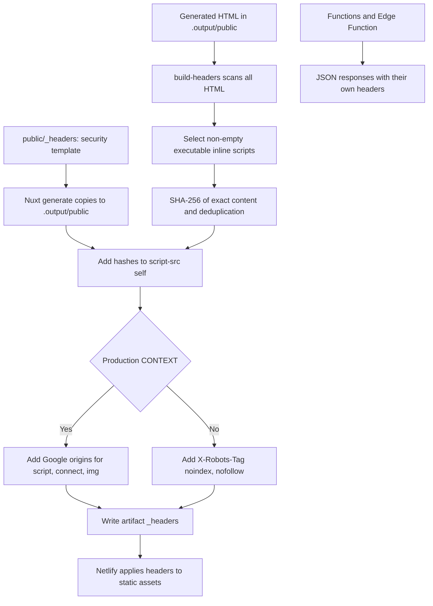

# Security

- Strict CSP in `public/_headers`: inline scripts carry hashes (computed by `scripts/build-headers.mjs` after each `generate`). Only the production build adds Google Analytics (`ANALYTICS_CSP_SOURCES` in `lib/analytics.ts`): `script-src` allows only `https://www.googletagmanager.com` (gtag.js); `connect-src` and `img-src` allow Google measurement origins.
- Conscious exception: `style-src 'unsafe-inline'`, because Nuxt UI and Vue generate inline styles. It affects styles only, not scripts.
- Outside production (`CONTEXT` other than `production` on Netlify) adds `X-Robots-Tag: noindex`.
- Hashed assets under `/_nuxt/` are served with one-year cache and `immutable`.
- GitHub Actions are pinned by commit SHA. Dependabot (`.github/dependabot.yml`) reviews npm and github-actions weekly on the default branch (master): grouped minor/patch, few open PRs, `chore(deps)` commits, no auto-merge.
- `npm run audit:check` (CI) fails on high/critical vulnerabilities except those accepted and justified in `scripts/audit.mjs` (each with `reviewBy`; the list is empty for now).
- No phone, email, or address anywhere: contact only via LinkedIn, CodePen, and GitHub.
- Zod runs without JIT (`lib/zod.ts`, where everything imports `z` from): its `new Function` probe would conflict with CSP (no `unsafe-eval`).
- Actions permissions: `contents: read` globally. Secrets used: `GITHUB_TOKEN` (gitleaks) and `NETLIFY_AUTH_TOKEN` / `NETLIFY_SITE_ID`, which exist only on the deploy step, never on a PR build.

## Header generation

Sources: [header script](../scripts/build-headers.mjs), [template](../public/_headers),
[analytics](../lib/analytics.ts), [Visits function](../netlify/functions/visits.ts), and [geo](../netlify/edge-functions/geo.ts).

- The selector excludes external scripts and JSON/JSON-LD types via its regular expression; it is not a general HTML parser. It covers inline scripts for consent, theme, sidebar, animations, and Books jump when they appear in HTML.
- The template includes HSTS, nosniff, `X-Frame-Options: DENY` and `frame-ancestors 'none'`, Referrer-Policy, Permissions-Policy, and COOP.
- Functions do not inherit `_headers`: `/geo` sets `no-store`, nosniff, and HSTS; Visits adds nosniff, HSTS, and on valid responses cache plus `x-visits-source`.
