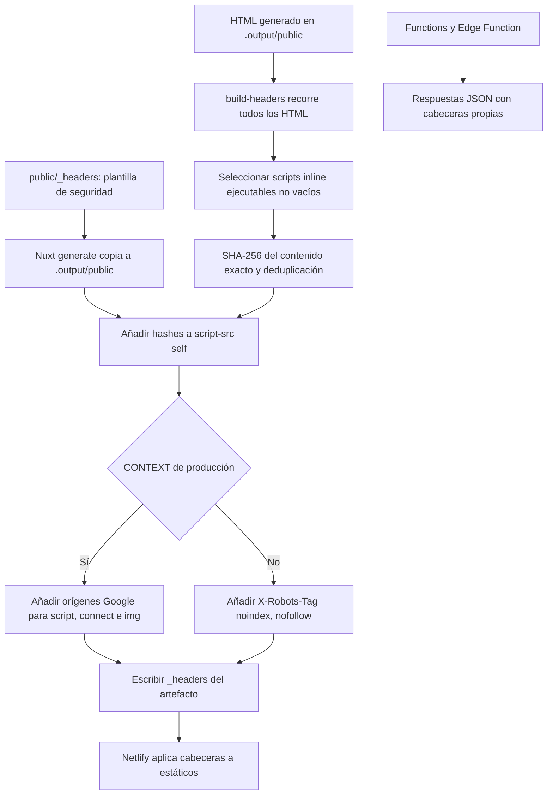

# Seguridad

- CSP estricta en `public/_headers`: los scripts inline llevan hash (lo calcula `scripts/build-headers.mjs` tras cada `generate`). Solo el build de producción añade Google Analytics (`ANALYTICS_CSP_SOURCES` en `lib/analytics.ts`): `script-src` admite únicamente `https://www.googletagmanager.com` (gtag.js); `connect-src` e `img-src`, los orígenes de medición de Google.
- Excepción consciente: `style-src 'unsafe-inline'`, porque Nuxt UI y Vue generan estilos inline. Solo afecta a estilos, no a scripts.
- Fuera de producción (`CONTEXT` distinto de `production` en Netlify) se añade `X-Robots-Tag: noindex`.
- Los assets con hash de `/_nuxt/` se sirven con caché de un año e `immutable`.
- Las acciones de GitHub se fijan por SHA de commit. Dependabot (`.github/dependabot.yml`) revisa npm y github-actions cada semana contra la rama por defecto (master): minor/patch agrupadas, pocas PRs abiertas, commits `chore(deps)` y sin auto-merge.
- `npm run audit:check` (CI) falla ante vulnerabilidades high/critical salvo las aceptadas y justificadas en `scripts/audit.mjs` (cada una con `reviewBy`; ahora la lista está vacía).
- Sin teléfono, email ni dirección en ningún sitio: contacto solo por LinkedIn, CodePen y GitHub.
- Zod va sin JIT (`lib/zod.ts`, de donde todo importa `z`): su prueba de `new Function` chocaría con la CSP (sin `unsafe-eval`).
- Permisos de Actions: `contents: read` global. Secretos usados: `GITHUB_TOKEN` (gitleaks) y `NETLIFY_AUTH_TOKEN` / `NETLIFY_SITE_ID`, que solo existen en el paso de deploy, nunca en el build de una PR.

## Generación de cabeceras

Fuentes: [script de cabeceras](../scripts/build-headers.mjs), [plantilla](../public/_headers),
[analytics](../lib/analytics.ts), [función Visitas](../netlify/functions/visits.ts) y [geo](../netlify/edge-functions/geo.ts).

- El selector excluye scripts externos y los tipos JSON/JSON-LD de su expresión regular; no es un parser HTML general. Cubre los inline de consentimiento, tema, sidebar, movimiento y salto de Libros cuando aparecen en el HTML.
- La plantilla incluye HSTS, nosniff, `X-Frame-Options: DENY` y `frame-ancestors 'none'`, Referrer-Policy, Permissions-Policy y COOP.
- Las funciones no heredan `_headers`: `/geo` fija `no-store`, nosniff y HSTS; Visitas añade nosniff, HSTS y, en respuestas válidas, caché y `x-visits-source`.
