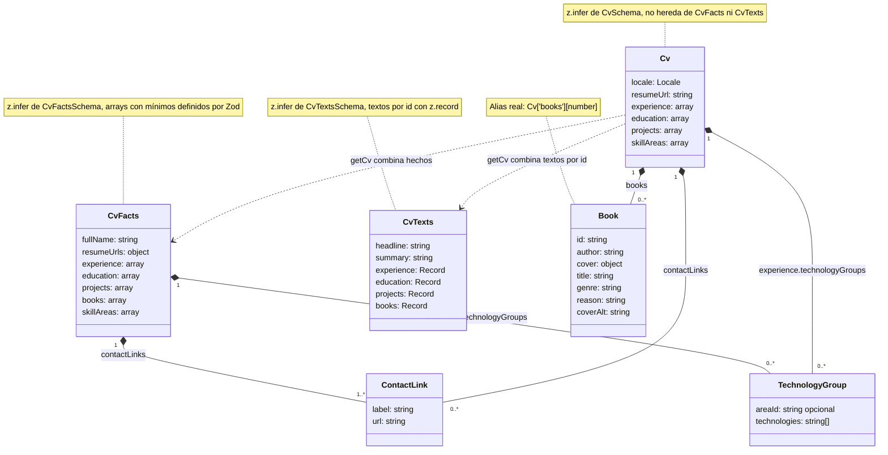
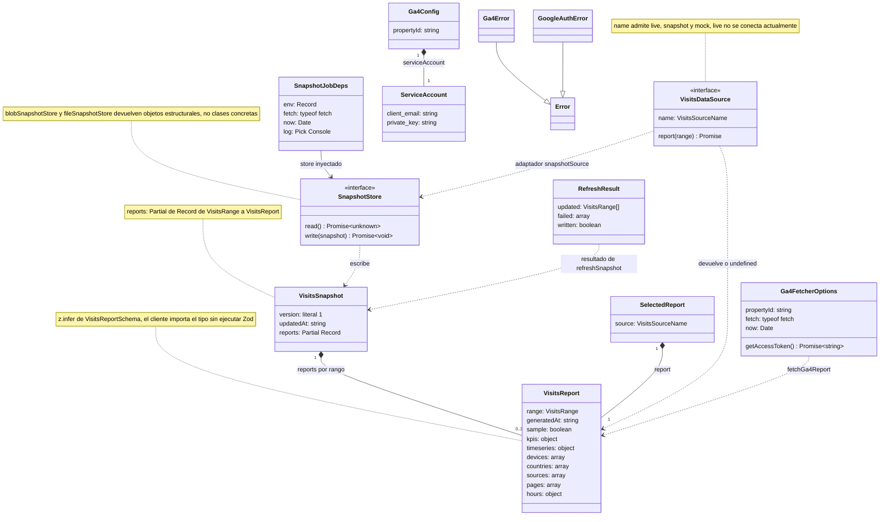
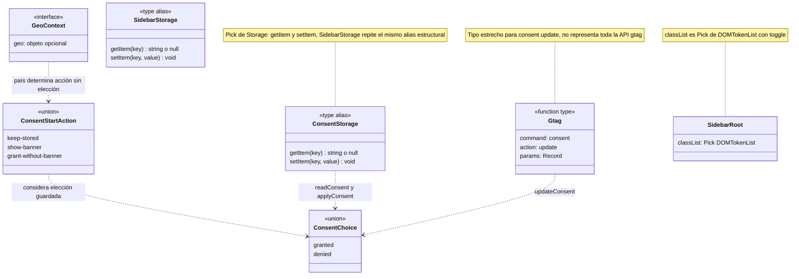

# Tipos y contratos

[Índice](README.md)

Son tipos e interfaces reales; las relaciones de composición representan propiedades,
no un modelo orientado a objetos impuesto sobre Vue.

## CV: hechos, traducciones y resultado

Fuentes: [data/schema.ts](../data/schema.ts), [data/cv.ts](../data/cv.ts).
Se omiten propiedades para legibilidad. `CvFacts`, `CvTexts`, `Cv`, `TechnologyGroup` y
`ContactLink` proceden de `z.infer<typeof ...Schema>`. `Locale` y `ProjectCategory` se derivan
con `(typeof CONSTANTE)[number]`; `Book` con acceso indexado. `textFor<T>` comparte el acceso
seguro a traducciones y `TEXTS_BY_LOCALE` usa `Record<Locale, CvTexts>`.
Los elementos finales de experiencia, educación, proyectos y libros se componen con
`ZodObject.extend(...)`: **extensión de esquemas**, no `extends` entre interfaces TypeScript.
No se inventan clases para esos elementos anónimos.

## Visitas e inversión de dependencias

Fuentes: [visitsSchema](../lib/visitsSchema.ts), [visits](../lib/visits.ts),
[snapshot](../lib/visitsSnapshot.ts), [fuentes](../lib/visitsSource.ts),
[GA4](../lib/visitsGa4.ts), [configuración GA4](../lib/visitsGa4Config.ts),
[cuenta de servicio](../lib/googleServiceAccount.ts), [tarea](../netlify/functions/visits-snapshot.ts).
Los campos de `ServiceAccount` son nombres del contrato, **no valores**.

- `VisitsRange = (typeof VISITS_RANGES)[number]`; el conjunto es `1d | 7d | 30d`.
- `VisitsKpis = VisitsReport['kpis']`, `CountryVisits = VisitsReport['countries'][number]`,
  `KpiKey = keyof VisitsKpis`: no duplican las estructuras del contrato.
- `VisitsFilter` se deriva de `VISITS_FILTERS`; `VisitsNote` es una unión discriminada por `kind`.
- `SnapshotJobDeps.log` usa `Pick<Console, 'info' | 'warn' | 'error'>`.
- `RunReportResponse` se infiere de Zod; los números de métricas llegan como cadenas y
  `rowsOf` los convierte con `Number(...)`, con sustitución por cero. **No usa `z.coerce`**.
- El endpoint valida el rango con `isVisitsRange`; `VisitsReportSchema` exige números ya
  tipados y valida en servidor. En cliente `isUsableReport` solo comprueba un subconjunto,
  no equivale a una validación Zod completa.

## Consentimiento y adaptadores del navegador

Fuentes: [analytics](../lib/analytics.ts), [consentRegion](../lib/consentRegion.ts),
[geo](../netlify/edge-functions/geo.ts), [sidebar](../lib/sidebar.ts).
`ANALYTICS_CSP_SOURCES` y `CONSENT_OPTIONS` usan `as const satisfies ...` para comprobar
forma sin perder literales. En los contratos mostrados no hay derivaciones con `Omit`
ni `Required`; no se añaden por ornamentación. El alias compartido entre
`ConsentStorage` y `SidebarStorage` es una posible extracción futura, no un refactor realizado aquí.
