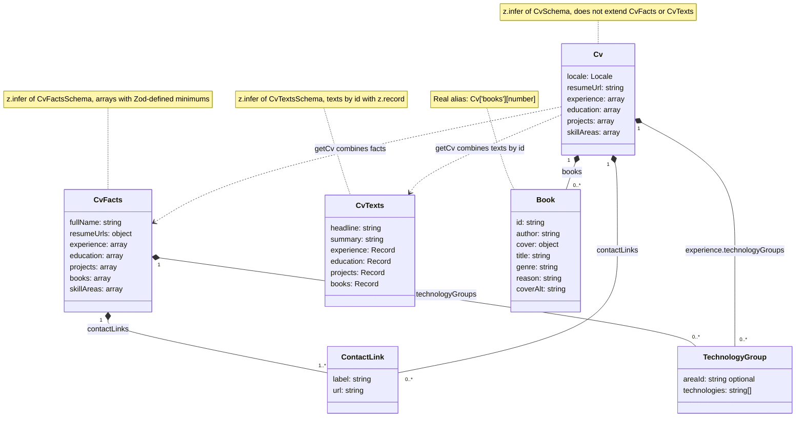
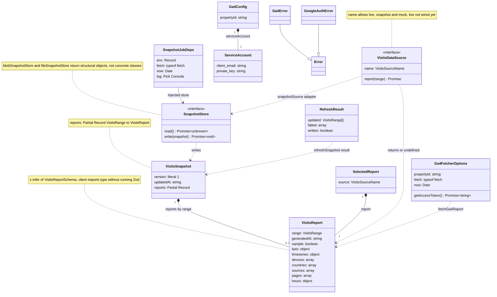
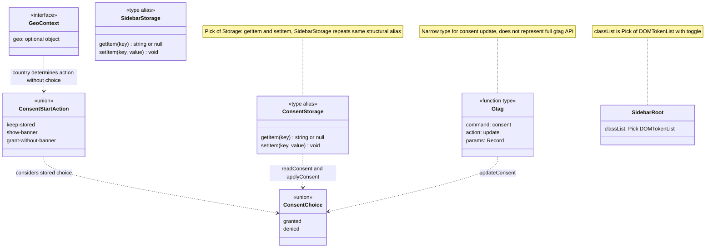

# Types and contracts

[Index](README.md)

These are real types and interfaces; composition relationships represent properties,
not an OOP model imposed on Vue.

## CV: facts, translations, and result

Sources: [data/schema.ts](../data/schema.ts), [data/cv.ts](../data/cv.ts).
Properties omitted for readability. `CvFacts`, `CvTexts`, `Cv`, `TechnologyGroup`, and
`ContactLink` come from `z.infer<typeof ...Schema>`. `Locale` and `ProjectCategory` derive
with `(typeof CONSTANT)[number]`; `Book` via indexed access. `textFor<T>` shares safe access
to translations and `TEXTS_BY_LOCALE` uses `Record<Locale, CvTexts>`.
Final elements of experience, education, projects, and books compose with
`ZodObject.extend(...)`: **schema extension**, not TypeScript `extends` between interfaces.
No invented classes for those anonymous elements.

## Visits and dependency inversion

Sources: [visitsSchema](../lib/visitsSchema.ts), [visits](../lib/visits.ts),
[snapshot](../lib/visitsSnapshot.ts), [sources](../lib/visitsSource.ts),
[GA4](../lib/visitsGa4.ts), [GA4 config](../lib/visitsGa4Config.ts),
[service account](../lib/googleServiceAccount.ts), [job](../netlify/functions/visits-snapshot.ts).
`ServiceAccount` fields are contract names, **not values**.

- `VisitsRange = (typeof VISITS_RANGES)[number]`; set is `1d | 7d | 30d`.
- `VisitsKpis = VisitsReport['kpis']`, `CountryVisits = VisitsReport['countries'][number]`,
  `KpiKey = keyof VisitsKpis`: do not duplicate contract structures.
- `VisitsFilter` derives from `VISITS_FILTERS`; `VisitsNote` is a union discriminated by `kind`.
- `SnapshotJobDeps.log` uses `Pick<Console, 'info' | 'warn' | 'error'>`.
- `RunReportResponse` inferred from Zod; metric numbers arrive as strings and
  `rowsOf` converts with `Number(...)`, defaulting to zero. **Does not use `z.coerce`**.
- Endpoint validates range with `isVisitsRange`; `VisitsReportSchema` requires typed numbers
  and validates on server. On client `isUsableReport` only checks a subset,
  not full Zod validation.

## Consent and browser adapters

Sources: [analytics](../lib/analytics.ts), [consentRegion](../lib/consentRegion.ts),
[geo](../netlify/edge-functions/geo.ts), [sidebar](../lib/sidebar.ts).
`ANALYTICS_CSP_SOURCES` and `CONSENT_OPTIONS` use `as const satisfies ...` to check
shape without losing literals. Shown contracts have no `Omit`
or `Required` derivations; none added for ornament. Shared alias between
`ConsentStorage` and `SidebarStorage` is a possible future extraction, not a refactor done here.
