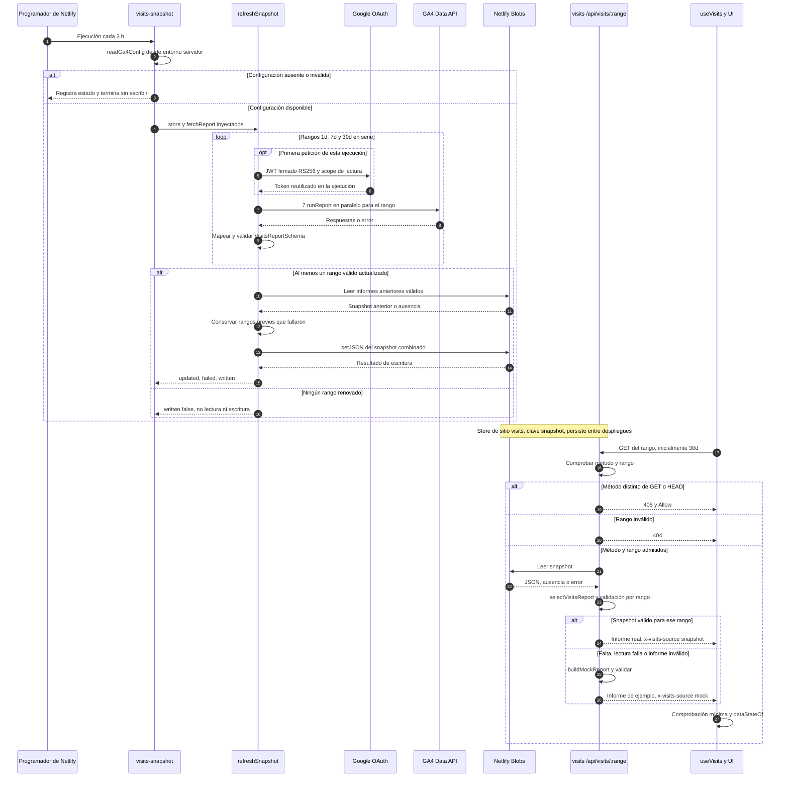
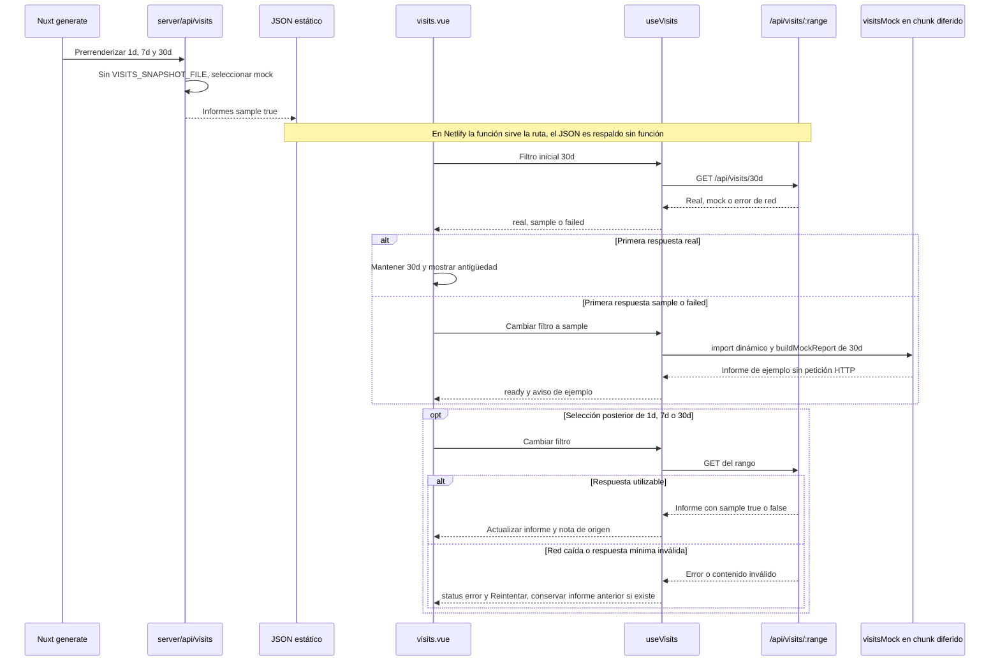

# Flujo de Visitas

[Índice](README.md) · [Tipos](tipos.md)

## Producción: actualización y lectura desacopladas

Fuentes: [tarea programada](../netlify/functions/visits-snapshot.ts),
[refreshSnapshot](../lib/visitsSnapshot.ts), [configuración y token compartido](../lib/visitsGa4Config.ts),
[OAuth](../lib/googleServiceAccount.ts), [GA4](../lib/visitsGa4.ts),
[Blobs](../lib/visitsBlobStore.ts), [endpoint](../netlify/functions/visits.ts),
[selección de fuentes](../lib/visitsSource.ts).
El horario es `0 */3 * * *`, evaluado en UTC por Netlify; en Atlantic/Canary varía con el horario estacional.
El endpoint público **no** consulta GA4 en directo. La fuente `live` existe como literal de tipo,
pero no se incluye en su lista de fuentes.

La actualización parcial conserva informes anteriores **válidos**, sin límite de antigüedad en
`snapshotReport`. Si falla la escritura de Blobs, el error se propaga: no hay un segundo almacén automático.
Un informe real con cero visitas sigue siendo real; la página presenta su estado vacío, no lo sustituye por mock.
El cliente revalida y la CDN puede cachear 10 minutos, sirviendo copia anterior mientras revalida.
Los países con menos de cinco visitas y los desconocidos se agregan en «Otros».

## Respaldo estático, elección inicial y error de red

Fuentes: [Nitro](../server/api/visits/%5Brange%5D.get.ts), [Nuxt](../nuxt.config.ts),
[useVisits](../app/composables/useVisits.ts), [filtro](../lib/visitsFilter.ts),
[página](../app/pages/visits.vue), [almacén local](../lib/visitsFileStore.ts),
[script local](../scripts/visits-snapshot.ts).
En desarrollo puede usarse un fichero mediante `VISITS_SNAPSHOT_FILE`; **no** debe definirse al generar
el respaldo estático. La primera decisión de filtro se realiza una sola vez en la página; no hay
un cambio automático a sample en cada fallo posterior.

**Límite temporal:** `visitsPeriods` calcula los días hasta ayer usando UTC. GA4 interpreta las fechas
del informe según la zona de la propiedad; el código no obtiene esa zona. No se asume equivalencia
con la hora local del visitante ni con Atlantic/Canary durante todo el año.
